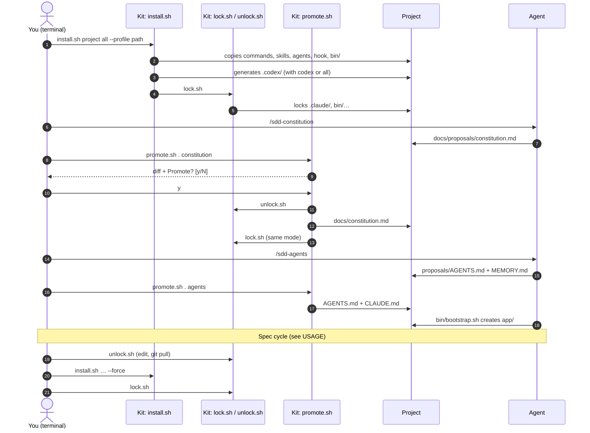
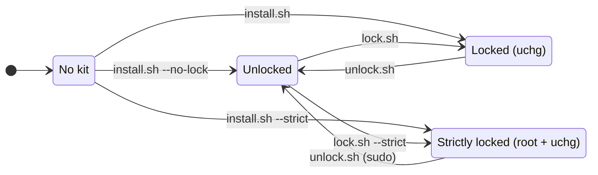

# SDD kit — Developer guide

For people who change the kit. To use it in a project, see [USAGE.md](USAGE.md).

## Rule number one: the kit is inert

This repository must not contain `.claude/`, `.opencode/`, `.codex/`, `.mcp.json`,
`CLAUDE.md` or `AGENTS.md`: if it did, the agent you use to develop the kit would load them
and start following the method (and its blocks). That is why the templates are named
`*.template.md` and the agent configuration lives in `protect/`. Check:

```bash
find . -name .claude -o -name .opencode -o -name .codex -o -name .mcp.json -o -name CLAUDE.md -o -name AGENTS.md   # empty
```

Do not test the kit by installing it inside this folder or in a subfolder of the repository
you develop in either: Claude Code can discover skills in subfolders.

## Layout

```
sdd-kit/
├── README.md               # project introduction
├── LICENSE                 # MIT
├── docs/USAGE.md, docs/DEVELOPMENT.md   # documentation source (with Mermaid diagrams)
├── docs-build/             # build.sh + template.html + mermaid.lua (pandoc); .cache/ = downloaded mermaid
├── install.sh              # installs into a project (+ profile) and locks it; also generates the Codex files
│                           #   ($sdd-* skills, .codex/hooks.json, config.toml and rules/sdd.rules)
├── lock.sh / unlock.sh     # chflags uchg (and root with --strict) on the protected paths
├── promote.sh              # docs/proposals/ → protected file, confirmed through /dev/tty
├── lib.sh                  # PROTECTED, LOCK_MARKER, project_dir, existing_protected, is_locked
├── protect/
│   ├── settings.json       # → .claude/settings.json (deny + hook registration)
│   ├── protect.sh          # → .claude/hooks/ and .codex/hooks/ (PreToolUse hook for both)
│   └── opencode.json       # → opencode.json (permission)
├── skills/sdd/SKILL.md     # → .claude/skills/sdd/ and .agents/skills/sdd/
├── commands/sdd-*.md       # → .claude/commands/ and .opencode/commands/
├── agents/
│   ├── claude/sdd-*.md     # → .claude/agents/ (Claude Code front matter + instructions)
│   └── opencode/sdd-*.yml  # only OpenCode mode and permissions; install.sh adds the description
│                           #   and instructions from claude/ (a single source)
│                           #   → .opencode/agents/sdd-*.md
├── templates/*.template.md # → docs/sdd-templates/
├── profiles/               # example profiles (python-uv, r-targets); installed only with --profile
└── tests/test-protect.sh   # hook regression tests
```

The generated HTML files (`README.html`, `docs/*.html`) are not committed (`.gitignore`).
The profiles in `profiles/` are examples: users keep their own outside the kit (see "Profiles").

## Project lifecycle and the scripts

How a project is created and what each script does. `install.sh`, `lock.sh`, `unlock.sh` and
`promote.sh` only exist in the kit: the project gets copies of what the agent uses
(commands, skill, hook, `bin/`), never the maintenance scripts.



1. `install.sh` copies into the project what the agent uses (commands, skills, agents, hook,
   the profile's `bin/`), generates the Codex configuration if requested, and ends by
   calling `lock.sh` (with `--strict`, the files are also handed over to root).
2. `promote.sh` asks for confirmation through `/dev/tty`, unlocks, copies the proposal,
   deletes it and locks again with the mode saved in `.claude/sdd-lock`.
3. For maintenance (editing by hand, `git pull`, reinstalling the kit): `unlock.sh`, the
   change, and `lock.sh`.

Protection states of a project:



- `install.sh` refuses to run on a locked project: it only works in *No kit* or *Unlocked*
  (`--force` to reinstall).
- `promote.sh` leaves the project in the same locked state it was in (or in *Locked (uchg)*
  if it was unlocked). In strict mode it asks for `sudo`.

## Design decisions

| Decision | Why |
|---|---|
| Constitution before AGENTS.md (separate `/sdd-agents` step) | AGENTS.md makes concrete what the constitution decides; the other way round there is nothing concrete to write yet |
| No stack in the skill or the commands | The commands say "the test command in AGENTS.md", never `node --test`, `pytest`… The stack comes in through the constitution or a profile |
| Product in `app/`, method outside | Clean packaging and per-folder permissions (implementer → `app/`, planner → `specs/`) |
| Specs outside `app/`, same repository | They are a record of decisions, not product; but they evolve in the same commits as the code (*spec-anchored*) |
| Proposal + promotion | The agent never writes protected files, not even during bootstrap. A person promotes them |
| Three layers (permissions, hook, `uchg`) | None is enough alone: permissions do not see Bash, the hook is heuristic, `uchg` stops everything but only on what already exists |
| `--strict` (root + `uchg`) | In normal mode the agent runs as the same user who owns the flag. `expect`/`script` can fake a terminal, so the `promote.sh` confirmation is not a barrier |
| Containers only through `bin/` | Free use of `docker` amounts to access to the whole disk. The `bin/` scripts mount only `app/`, with no network and no capabilities |
| Profiles outside the kit | Each person's stack and tools are personal (Docker image, scaffolding tool…). The kit only defines the format and installs it |
| `--net` decided by the hook | A general convention for any `bin/` script, with no per-profile rules in the permissions |
| Read-only phases written into the command | `agent: plan` only exists in OpenCode. The front matter only uses `description` and `argument-hint` |
| Human review once, at the end, and only of what already passed the automatic checks | Reviewing something that later fails the tests is wasted time. `/sdd-validate` has two phases |
| Commands without approval, except `--net` | Approving every command adds nothing once the dangerous ones are forbidden. In OpenCode (no hook) this is an accepted risk |
| git read-only, no `gh` | Commits belong to the user, who reviews `git diff` |
| Delete with `trash`, never `rm` | What an agent deletes can be recovered from the Trash. `rm` is blocked with an explicit message instead of being silently replaced: the agent learns to use `trash` |
| `.mcp.json` and `* mcp` protected | An MCP server gives the agent new tools: only the user adds them |
| Agents: a single source | The description and instructions live in `agents/claude/`; OpenCode only adds `mode` and permissions. That way they do not drift apart |
| Codex generated, not duplicated | Commands are turned into skills and the rules are generated from the `bin/` scripts and the profile's `deny-commands` |

### The three protection layers

| Layer | File | What it stops | Agent |
|---|---|---|---|
| 1. Permissions / rules | `protect/settings.json`, `protect/opencode.json` and, in Codex, `.codex/rules/sdd.rules` + its sandbox | By default every command is allowed (`allow: ["Bash"]` and `bash "*": "allow"`, so that you do not approve each command) except: edit tools on protected paths; `chmod`, `chflags`, `chown`, `xattr`, `sudo`, `docker`, `podman` (in OpenCode, `bin/*--net*` also asks for approval and the profile's `deny-commands` are denied) | All three |
| 2. `PreToolUse` hook | `protect/protect.sh` | Edits (resolves `..`, symlinks and case, since APFS is case-insensitive); Bash that mentions protected paths and is not read-only, uses the kit scripts, changes the git repository (read-only: status, diff, log, show…; no gh), deletes with `rm`/`unlink`/`shred`/`find -delete` (use `trash`), calls containers or runs a command from `.claude/sdd-deny-commands`. It allows running `bin/*.sh`; with `--net` it answers `ask` (in Claude Code; in Codex the rule asks) | Claude Code and Codex |
| 3. Operating system | `lock.sh` (`chflags uchg`; `--strict` adds root) | Any write or deletion on what is locked, even from a container running as root (tested) | All three |

`lock.sh` saves the mode in `.claude/sdd-lock` (protected) so that `promote.sh` locks again
the same way.

### Agents (coordinator and subagents)

| Agent | Tools (Claude Code) | Writes (hook / OpenCode) | Bash |
|---|---|---|---|
| `sdd-coordinator` (main) | `Agent(sdd-planner, sdd-implementer, sdd-reviewer)`, Read, Grep, Glob, Skill | Nothing | No |
| `sdd-planner` | Read, Grep, Glob, Write, Edit, Skill | `specs/**` | No |
| `sdd-implementer` | Read, Grep, Glob, Write, Edit, Bash, Skill | `app/**`, `specs/*/tasks.md`, `MEMORY.md` | Yes (normal hook rules) |
| `sdd-reviewer` | Read, Grep, Glob, Bash, Skill | Nothing | Only `bin/*.sh`, reads and `git diff/log/status/show` |

- **Claude Code**: a subagent cannot start other subagents, so the coordinator is the **main
  session** (`claude --agent sdd-coordinator`, or the `"agent"` setting that
  `install.sh --coordinator` writes). The hook receives `agent_type` in every call (tested:
  the main session's too), and uses it to apply per-role permissions (`check_role_edit` and
  step 0 of `check_bash`). A session without an agent has no `agent_type` and is unaffected.
- **OpenCode**: native per-agent permissions (`mode`, `permissions` with
  `action/resource/effect`). OpenCode places them after the project-wide ones
  (`opencode debug agents`). Since the project allows the whole terminal, the reviewer has its
  own closed list (`bin/*` without `--net`, `git status/diff/log/show`, `ls`, `cat`, `grep`…).
- **No fixed model**: the subagents inherit the session's model (models change too often).
- The product folder `app/` is hard-coded in the hook and in the OpenCode headers.
- Tested live (Claude Code, Haiku): the planner writes in `specs/` and the hook blocks `app/`
  for it; the reviewer cannot write through Bash; the coordinator has neither write tools nor
  Bash.

### Codex

`install.sh … codex` (or `all`) generates the Codex configuration from the same pieces:

| Piece | How it is generated |
|---|---|
| Skills | The same ones, in `.agents/skills/` (Codex and OpenCode both read that folder) |
| Commands | Each `commands/sdd-*.md` → `.agents/skills/sdd-*/SKILL.md` (description "only when the user invokes it", `$1`/`$2`/`$ARGUMENTS` → names from `argument-hint`, `/sdd-` → `$sdd-`) + `agents/openai.yaml` with `allow_implicit_invocation: false` |
| Hook | The same `protect.sh` in `.codex/hooks/`; `.codex/hooks.json` searches for it upwards from Codex's `cwd` |
| Rules | `.codex/rules/sdd.rules` (Starlark): `allow` for each `bin/*.sh` (Docker outside the sandbox), `prompt` with `--net`, `forbidden` for git commands that write, `gh`, containers, `chmod`/`chflags`/`sudo`…, `* mcp` and the profile's `deny-commands` |
| Sandbox | `.codex/config.toml`: `workspace-write`, `network_access = false` |

How the hook differs in Codex (tested live with `codex exec`):
- There is no `CLAUDE_PROJECT_DIR`: the root is the first folder from `cwd` upwards with
  `.codex/` or `.claude/`, and relative paths are resolved from `cwd`.
- Edits arrive as `tool_name: "apply_patch"` with the patch in `tool_input.command`; the hook
  takes the paths from `*** Add/Update/Delete File:` and `*** Move to:`.
- There is no `agent_type` (no per-role permissions) and no `ask` decision (the rule asks for
  `--net`).
- The Codex sandbox does not allow the Docker socket: that is why the `bin/` scripts get
  `allow` in the rules.
- Codex only loads `.codex/` if the project is trusted (stored in the user's
  `~/.codex/config.toml`) and asks you to approve the hooks (`/hooks`). To test without the UI:
  `codex exec --dangerously-bypass-hook-trust -s workspace-write -m <model> "…"`.
- The rules can be tested without spending quota:
  `codex execpolicy check --rules .codex/rules/sdd.rules -- <command>`.
  Careful in zsh: pass the command as separate words, not as a single unquoted variable.

## Where things live (changes that touch several files)

**List of protected paths** — it is repeated; if you add or remove one, change all of them:
- `lib.sh` → `PROTECTED` (operating system lock)
- `protect/protect.sh` → `is_protected()`, the regular expression in step 2 of `check_bash()` and the message in `block_protected()`
- `protect/settings.json` → `permissions.deny` (`Edit(./…)`)
- `protect/opencode.json` → `permission.edit`
- `skills/sdd/SKILL.md` → "Protected files"
- `templates/AGENTS.template.md` (🚫 Never) and `templates/constitution.template.md` (Repository layout)
- `docs/USAGE.md` → "Protected files"
- `tests/test-protect.sh` → add cases

**Forbidden commands** (`chflags`, `chmod`, `docker`, git commands that write, `rm`…):
`protect.sh` (steps 1, 1a, 1b, 1d and 1e), `settings.json`, `opencode.json` and the Codex
rules generation in `install.sh`. Add cases to `tests/test-protect.sh`.

**The product folder `app/`**: hard-coded in `check_role_edit` (hook), in the
`agents/opencode/` headers and in the profiles' scripts.

**Method phases**: `skills/sdd/SKILL.md` (flow), the matching command, the templates and the
table in USAGE.md.

**Code discipline** (don't assume, minimum code, touch only what you must, success criteria):
the rules live in `skills/sdd/SKILL.md` ("Code discipline"), the single source for the three
tools. `agents/claude/sdd-implementer.md` and `commands/sdd-implement.md` / `sdd-feature.md`
point to it (OpenCode agents are generated from the Claude ones, and Codex skills from the
commands, so nothing else needs editing); the check is in `agents/claude/sdd-reviewer.md` and
`commands/sdd-validate.md` (phase 1). Documented in USAGE.md ("The method").

## Compatibility rules

- **Commands**: valid in Claude Code and OpenCode, and convertible into Codex skills. Front
  matter only with `description` and `argument-hint`. Arguments `$ARGUMENTS`, `$1`, `$2`
  (install.sh replaces them with the names in `argument-hint`); references to other commands
  written as `` `/sdd-x` `` or ` /sdd-x` (install.sh changes them to `$sdd-x`).
- **Scripts**: must work with macOS's **bash 3.2** (`/bin/bash`). Watch out for an empty
  `"${array[@]}"` under `set -u`, `declare -A`, `${var,,}` and `readarray`: they do not exist
  or they fail.
- **macOS**: `chflags`, `find -flags`, `stat -f` and `readlink -f` are BSD/macOS. The kit does
  not work as is on Linux.
- **Commands for the agent**: no interactive terminal (no `-it`, no aliases or functions from
  the user's shell).
- **The hook fails closed**: if it cannot read the request (no `jq` or `python3`), it blocks.
- **`set -e` and `[[ … ]] && …`**: if it is the last statement of a function and the
  condition is false, the function returns 1 and the script stops **silently** (it happened
  to `install.sh` when skipping an existing file). Use `if … then … fi`.
- **Tests run from zsh**: an unquoted variable is not split into words (`$c` holding
  "git commit -m x" arrives as a single argument). Use `eval` or explicit lists.

## Testing

### 1. Hook (fast, no agent)
```bash
tests/test-protect.sh        # 134 cases (BLOCK / ALLOW / ASK, per agent and in Codex mode); must end with "0 failed"
```
Every time you change `protect.sh` or the list of protected paths, add cases and run it.

### 2. Scripts (temporary project)
```bash
P=$(mktemp -d); ./install.sh "$P" both --profile <path-to-a-profile>
echo x >> "$P/bin/<script>.sh"   # must fail: Operation not permitted
./unlock.sh "$P"                   # ALWAYS before deleting it: with uchg, deleting fails
```
- `promote.sh` without a terminal (`</dev/null`) must abort. With a terminal it can be tested
  with `expect -c "spawn ./promote.sh $P constitution; expect {\[y/N\]}; send \"y\r\"; expect eof"`.
- Run the scripts with `/bin/bash script.sh` to catch bash 3.2 incompatibilities.

### 3. A profile
With a profile installed in the temporary project: `/bin/bash bin/bootstrap.sh` twice (it
must be idempotent), one test and the profile's test command; if it uses containers, check
that there is no network without `--net` and there is with it, and that the container sees
nothing outside `app/`.

### 4. With a real agent
1. `mkdir ../sdd-sandbox && ./install.sh ../sdd-sandbox both [--profile …]` (outside this
   repository).
2. New session in the sandbox. Go through the whole flow (see Quick start in USAGE.md).
3. Security: ask the agent to edit `AGENTS.md`, to change it with `echo >>`, to edit
   `.claude/settings.json`, to run `chflags`, `promote.sh` and `docker`. Everything must be
   blocked.
4. Repeat in OpenCode (no hook there: only layers 1 and 3) and in Codex.
5. Fix things here and reinstall: `unlock.sh` + `install.sh --force`.

Tests without the UI (cheap with small models):
- **Claude Code**: `command claude -p "…" --model haiku [--agent sdd-planner]
  [--permission-mode bypassPermissions]` (`command` skips functions from the user's shell).
  In a folder that has not been trusted, Claude Code **ignores the project's `allow`** (it
  warns at start-up): to test approvals, use a trusted project.
- **Codex**: `codex exec --skip-git-repo-check --dangerously-bypass-hook-trust -s workspace-write
  -m <model> "…"`. **Codex marks as trusted** every folder it runs in, in the user's
  `~/.codex/config.toml`: remove those entries afterwards.
- **OpenCode**: `opencode debug config` and `opencode debug agents` show how it reads the
  permissions and the agents (the first run in a new folder sometimes comes out empty).

**Not verified yet**: that Claude Code's `Edit(./…)` rule blocks on its own (in the tests the
hook always acted first) and that OpenCode applies the last matching rule in a real session
(it reads the configuration correctly).

## Documentation

- Only the Markdown files are edited (`README.md`, `docs/USAGE.md`, `docs/DEVELOPMENT.md`);
  the HTML versions are regenerated locally and not committed:
  ```bash
  docs-build/build.sh     # needs pandoc and curl; the first time it downloads mermaid 11.4.1
                          # into docs-build/.cache/ (can be deleted; it is downloaded again)
  ```
  Each HTML file embeds Mermaid (~2.5 MB) and works offline, with a side table of contents
  and dark mode. Links between the documents are rewritten to `.html` (filter `mermaid.lua`).
- Diagrams go in ` ```mermaid ` blocks: GitHub renders them; the VS Code preview needs the
  *Markdown Preview Mermaid Support* extension.
- When you touch a diagram, check the HTML in a browser: a sequence diagram with long
  messages shrinks until it is unreadable (keep messages short), and in flowcharts the title
  of a long `subgraph` is hidden by the first node.
- The documentation is not copied into projects.

## Profiles

The method does not depend on any profile. The kit includes two examples in `profiles/`
(`python-uv` and `r-targets`); users keep their own in a folder of their own and pass it with
`install.sh --profile <path>`. The format:

```
<profile>/
├── profile.md     → docs/sdd-templates/profile.md   (required)
├── skills/<n>/    → .claude/skills/<n>/ and .agents/skills/<n>/
├── bin/*          → bin/ (protected, executable)
└── deny-commands  → .claude/sdd-deny-commands (hook) and deny rules in opencode.json
```

- **`profile.md`**: decisions for the constitution (with `<…>` for what is left open),
  suggested principles, layout of `app/`, a commands block for AGENTS.md, limits and
  bootstrap. It is used once, when the constitution and AGENTS.md are created.
- **`skills/`**: day-to-day knowledge (how to run, where things go, how to test, pitfalls).
  The agent loads it when it works on that stack; AGENTS.md only names it.
- **`bin/`**: scripts the agent runs but cannot change. Conventions: `bootstrap.sh` sets up
  `app/` (idempotent); if there are containers, a wrapper that mounts only `app/`, with no
  network by default, with `--cap-drop ALL`, and that accepts `--net` (the hook asks for
  approval). The kit's permissions do not need to change.
- **`deny-commands`**: one command per line (`#` for comments) that never runs on the Mac
  because it must only run in the container (`python`, `uv`, `Rscript`…). The hook checks the
  command of each part of the line (after `|`, `;`, `&`, skipping `VAR=value`, `env`,
  `exec`…), not every word: `bin/py.sh uv run` is still allowed. For OpenCode, `install.sh`
  adds `"<cmd>"` and `"<cmd> *"` as `deny` in `opencode.json` (needs `jq`).
- **Visual check** (recommended): a way for the agent to see the result and check it before
  asking for a human review. Depending on the kind of work:
  - *HTML reports generated in the container*: a screenshot script in `bin/` (the r-targets
    profile ships `bin/shot.sh`, which uses the headless Chromium inside the image).
  - *Web development*: a browser MCP server (e.g. Chrome DevTools or Playwright), set up by the
    user in `.mcp.json`.
  - *Apps with a graphical interface (desktop, mobile)*: **not designed yet**.
- The profiles folder must be inert, like the kit (no `.claude/`, `CLAUDE.md`, `AGENTS.md`).

Ideas: **Xcode** (no Docker: `xcodebuild test`, XCTest/XCUITest, the `.xcodeproj` inside
`app/`; isolation with the Claude Code sandbox).

## Known limitations

- The hook's Bash filter is heuristic: obfuscated commands, or scripts in `app/` that write
  to protected paths or call `docker`, are not detected. Layer 3 stops the writes; reads of
  the rest of the disk through Docker could only be prevented with a sandbox.
- `bin/` is only recognised as the project folder at the start of a word or after `./` or
  `../` (so as not to confuse it with `/bin/bash` or `/usr/bin/env`). A path such as
  `app/../bin/` is not detected by the hook: layer 3 stops it.
- Any redirection (`>`) in a command that uses a `bin/` script is blocked.
- The `--net` approval is text-based: a `bin/` script that turned on the network without
  `--net` would not ask for approval. That is the responsibility of whoever writes the profile.
- OpenCode has no hook (layer 2) and allows the whole terminal except what is forbidden: a
  command that is not forbidden and writes or deletes outside the project would run without
  asking.
- Codex: no per-role permissions (the hook gets no `agent_type`) and, since the `bin/`
  scripts and `trash` run outside its sandbox through the rules, there is no Codex sandbox
  inside them.
- What is deleted **inside a container** (`bin/r.sh sh -c 'rm …'`) does not go to the Trash
  (it can only affect `app/`).
- Claude Code only applies the kit's `allow` in trusted projects.

## Origin

The kit started from the spec-driven workflow taught in the BIG School course
*Curso de Desarrollo con IA – El Nuevo Programador* (see the [README](../README.md)), which
shows the method on a single example project with one agent. This kit is an independent
rewrite that generalises it:

- No fixed stack: tests, tools and verification are whatever the constitution and AGENTS.md
  (or a profile) say.
- Logic kept apart from I/O and interface, with clock, network and disk injectable.
- A separate `/sdd-agents` step, the product in `app/`, and protected files changed only
  through proposals that a person promotes.
- Read-only phases written into each command, so they work the same in every agent.
- Claude Code does not read `AGENTS.md` on its own: `CLAUDE.md` contains `@AGENTS.md`.
- Support for Claude Code, OpenCode and Codex, protection layers and an optional
  multi-agent coordinator.

## To do

- Try the whole flow with the coordinator in a real project (Claude Code and OpenCode).
- OpenCode: confirm in a real session that it applies the **last** matching rule (each
  agent's permissions and the `deny` rules come after `"*": "allow"`).
- Codex, phase 2: the agents as `.codex/agents/*.toml` (instructions only: Codex does not say
  which agent makes each call and does not restrict tools per agent, except turning Bash off).
- An Xcode example profile.
- A hook for OpenCode (`tool.execute.before` plugin).
- Visual check for apps with a graphical interface (not HTML): screenshots of the running app
  or UI tests (e.g. XCUITest in Xcode).
- Consider the Claude Code sandbox as a fourth layer (it also restricts reads and network).
