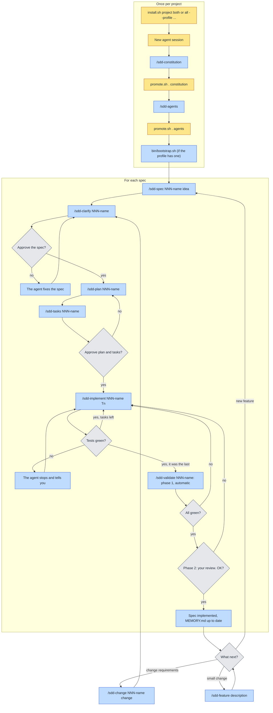
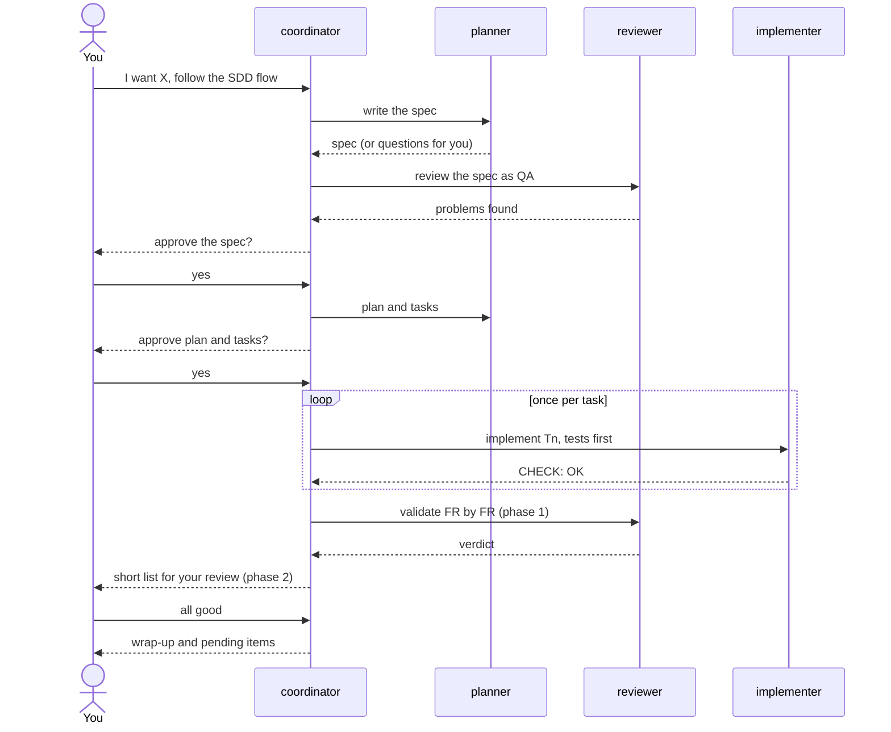

# SDD kit (Spec-Driven Development) — Usage guide

An SDD method for working with an AI coding agent (**Claude Code**, **OpenCode** or **Codex**)
on any stack: first you decide *what* to build (spec), then *how* (plan), and the agent
implements one task at a time, tests first. The files that set the project's rules are
protected: the agent cannot change them.

> Want to change the kit itself? Read [DEVELOPMENT.md](DEVELOPMENT.md).

## Quick start

```bash
# 1. Install into a project (new or existing)
<kit-path>/install.sh ~/projects/my-project both                         # Claude Code + OpenCode
<kit-path>/install.sh ~/projects/my-project all --profile ~/my-profile   # all three, with your own profile
<kit-path>/install.sh ~/projects/my-project all --coordinator            # with the coordinator as default agent

# 2. Open a NEW agent session in the project (and trust the folder if asked)
cd ~/projects/my-project && claude        # or: opencode, codex
```

In the agent:

```
/sdd-constitution                 → the agent interviews you and proposes the constitution
```
In your terminal: `<kit-path>/promote.sh . constitution`
```
/sdd-agents                       → proposes AGENTS.md and creates MEMORY.md
```
In your terminal: `<kit-path>/promote.sh . agents`
```
/sdd-spec 001-name initial idea…
/sdd-clarify 001-name  →  /sdd-plan 001-name  →  /sdd-tasks 001-name
/sdd-implement 001-name T1   (then T2, T3…, one at a time)
/sdd-validate 001-name
```

If you get lost: `/sdd-status` tells you which phase you are in and which command comes next.

In **Codex** the commands are skills and are typed with `$`: `$sdd-constitution`,
`$sdd-spec 001-name …`, `$sdd-status`… (see "Using the kit with Codex").

## The method



Yellow: you do it in your terminal. Blue: the agent does it (`/sdd-*` commands; `$sdd-*` in
Codex). Grey: decisions; approvals are always yours. At any time, `/sdd-status` tells you
where you are.

| Phase | Command | The agent writes | Result |
|---|---|---|---|
| Constitution | `/sdd-constitution` | `docs/proposals/constitution.md` | Principles, stack and tools → you promote it |
| Bootstrap | `/sdd-agents` | `docs/proposals/AGENTS.md`, `MEMORY.md` | Operating manual derived from the constitution → you promote it |
| Spec | `/sdd-spec 001-name idea…` | `specs/001-name/spec.md` | WHAT and WHY, requirements in EARS |
| Clarification | `/sdd-clarify 001-name` | nothing | Ambiguities, contradictions, gaps |
| Plan | `/sdd-plan 001-name` | `plan.md` | HOW, with the coverage of each FR |
| Tasks | `/sdd-tasks 001-name` | `tasks.md` | 20-30 minute tasks, each with "Done when" |
| Implementation | `/sdd-implement 001-name T1` | code + tests in `app/` | One task, tests first |
| Validation | `/sdd-validate 001-name` | nothing | 1) Everything automatic, FR by FR; 2) only if all of it passes, a short list of what you need to look at |
| Change | `/sdd-change 001-name change…` | `spec.md` | Spec updated before the code |
| Quick change | `/sdd-feature description…` | code + tests, `MEMORY.md` | A small change without a spec: short plan, your approval, test first |
| Status | `/sdd-status [001-name]` | nothing | Current phase and next command |

**Golden rules**
- No phase moves on without your explicit approval.
- The constitution rules over the spec, and the spec over the code.
- Requirement change: spec → plan → tasks → code.
- One task at a time; never move on with failing tests.

**Code discipline** (in the `sdd` skill, so Claude Code, OpenCode and Codex all follow it)
- *Don't assume*: if something is ambiguous or missing, the agent stops and asks.
- *Minimum code*: the simplest code that makes the task's tests pass; no extra features,
  options, abstractions or error handling.
- *Touch only what you must*: no unrelated refactoring, reformatting or renaming. Anything else
  the agent notices is reported, not fixed. Before finishing, it reads its own `git diff` and
  reverts its own changes that the task does not justify.
- *Success criteria*: the tests and the "Done when" of each task are known before coding.

`/sdd-validate` enforces it: a changed line that no task or FR justifies, or code beyond what
the spec requires, is a `FAIL` in phase 1.

**Requirements in EARS** (one sentence = one verifiable behaviour):
`WHEN <event>, THE SYSTEM SHALL <response>` · `IF <unwanted condition>, THEN THE SYSTEM SHALL <response>` ·
`WHILE <state>, THE SYSTEM SHALL <response>` · `THE SYSTEM SHALL <permanent behaviour>`.

## Using the kit with Codex

Install with `codex` (or `all`). In Codex the kit works like this:

| | Claude Code / OpenCode | Codex |
|---|---|---|
| Commands | `/sdd-spec 001-name …` | Explicitly invoked skills: `$sdd-spec 001-name …` |
| AGENTS.md and skills | `CLAUDE.md` → `AGENTS.md`; `.claude/skills` or `.agents/skills` | Read automatically (`AGENTS.md`, `.agents/skills/`) |
| Protections | Hook (Claude Code) and permissions | The same hook (`.codex/hooks.json`), rules (`.codex/rules/sdd.rules`) and the **Codex sandbox** (no network, writes only inside the project) |
| `bin/` scripts (Docker) | Normal | Run **outside** the sandbox through an `allow` rule (they isolate on their own); with `--net`, Codex asks you |
| Coordinator | Yes | Not yet (see DEVELOPMENT) |

**Before starting, in every new project:**
1. Open `codex` in the project folder and **mark the project as trusted**: otherwise Codex
   ignores `.codex/` (hook, rules and sandbox) and the project has no protections.
2. Review and approve the hook with `/hooks` (Codex asks you to review it, and again whenever
   it changes).
3. Use your ChatGPT subscription (`codex login`) and a model your plan supports.

## Working with the coordinator (multi-agent)

Instead of starting each phase yourself with a command, you can work with a **coordinator**
that chains the flow and splits the work among three subagents:

| Agent | Role | Can write to | Runs commands |
|---|---|---|---|
| `sdd-coordinator` | Drives the phases, passes the context, asks you for approvals | Nothing | No |
| `sdd-planner` | Spec, plan, tasks and spec changes | `specs/` | No |
| `sdd-implementer` | One task at a time, tests first | `app/`, `tasks.md`, `MEMORY.md` | Yes |
| `sdd-reviewer` | Reviews the spec (QA) and validates FR by FR | Nothing | Only `bin/` and reads |



If validation fails, the coordinator goes back to the implementer with the list of failures
(two rounds at most) before asking you anything.

**How to use it:**
- Install with `--coordinator` and the coordinator becomes the default agent when Claude Code
  opens the project. Without that option: `claude --agent sdd-coordinator`. In OpenCode,
  switch to the `sdd-coordinator` agent with Tab.
- Tell it what you want (*"I want to add X; follow the SDD flow"*) or use the usual `/sdd-*`
  commands: it hands them out to the subagents.
- It stops for you to approve the spec, the plan with its tasks and, at the end, the human
  review (only if the automatic validation passes in full). The constitution, AGENTS.md and
  `promote.sh` are still up to you, as always.

**Compared with working without the coordinator:** more automatic, independent review (the
one who validates did not write the code), a clean context in each subagent and real
per-role permissions (enforced by the hook in Claude Code). It uses more tokens and each step
is harder to follow: while you are learning a language or the method, the plain agent lets
you see better what is going on.

## If you change code by hand

You can edit the code whenever you like: the protections only apply to the agent, and
`app/`, `specs/` and `MEMORY.md` are not locked. What matters is that the spec and the code
keep saying the same thing.

| Your change | What to do next |
|---|---|
| A fix or improvement that does not change behaviour | The AGENTS.md check (e.g. `bin/check.sh`) in OK |
| You implement a task from `tasks.md` yourself | Mark it as done, check in OK and, when the spec is finished, `/sdd-validate` |
| You change the behaviour | `/sdd-change NNN-name I changed X so that it does Y`, then `/sdd-validate` |
| New code outside any spec | If it stays, a spec (even a small one) or `/sdd-feature`; if it is an experiment, a git branch |

- **Pass the check before moving on**: otherwise the agent's next task will fail on it.
- **Run your code with the `bin/` scripts** (e.g. `bin/py.sh`), not with the Python or R on
  your Mac: that way it is tested in the same environment the agent uses.
- **Tell the agent** (or write it down in `MEMORY.md`). If it finds code it did not expect,
  the `sdd` skill tells it not to undo it and to ask you.
- **To learn**: write part of it yourself and ask *"review my code for X against spec NNN and
  explain what you would improve"*.

## Project layout

```
project/
├── AGENTS.md, CLAUDE.md, MEMORY.md   ← method
├── docs/        constitution.md, proposals/, sdd-templates/
├── specs/       001-name/{spec,plan,tasks}.md
├── bin/         profile scripts (if any)
├── .claude/ .opencode/ .agents/ .codex/   ← agent configuration
├── .mcp.json    MCP servers (empty; only you set them up)
└── app/         ← product: code, tests and build configuration
```

- **`app/` is the product**: it builds and tests on its own; for production only that folder
  is packaged. Tests live inside it, next to the code.
- **Everything else is the method**: specs, constitution, memory and agent configuration.
  It does not go to production, but it does live in the same repository as the code.
- **The constitution** records the decisions (principles, stack, tools, tests,
  verification, what is forbidden). **AGENTS.md** is the operating manual derived from it
  (exact commands, layout, conventions, limits). That is why the constitution comes first.

## Installation

```bash
<kit-path>/install.sh <project> [claude|opencode|codex|both|all] [--profile <path>] [--coordinator] [--force] [--no-lock] [--strict]
```

| Option | Effect |
|---|---|
| `claude` / `opencode` / `codex` / `both` / `all` | Which agent to install for (`both` = Claude Code + OpenCode, the default; `all` = the three) |
| `--profile <path>` | Folder with your own profile for a stack (see Profiles) |
| `--coordinator` | The coordinator becomes the default agent in Claude Code (see "Working with the coordinator") |
| `--force` | Overwrites files that already exist |
| `--no-lock` | Does not lock the protected files at the end |
| `--strict` | Stronger lock with `sudo` (recommended for real projects; see Protected files) |

- Nothing is overwritten without `--force`. If you already had `.claude/settings.json` or
  `opencode.json`, it warns you so that you merge the protection settings by hand.
- Then **open a new agent session**: commands, skill and protections are loaded when the
  session starts.
- To reinstall (e.g. with a new version of the kit): `unlock.sh <project>` and
  `install.sh <project> … --force`.

## Profiles

The method has no stack of its own. A **profile** is a folder that adapts it to the way you
work with a given stack. The kit includes two examples in [`profiles/`](../profiles/README.md)
(`python-uv` and `r-targets`); for your own, copy one to a folder outside the kit and change
it. The format:

```
my-profile/
├── profile.md     starting values for /sdd-constitution and /sdd-agents
├── skills/<n>/    skill for day-to-day work (how to run, test, pitfalls)
├── bin/           scripts (e.g. the one that runs the container; bootstrap.sh sets up app/)
└── deny-commands  commands that only run in the container (python, Rscript…)
```

```bash
<kit-path>/install.sh <project> both --profile <profile-path>
```

- `profile.md` → `docs/sdd-templates/profile.md`: `/sdd-constitution` proposes its values and
  only asks about what is left open.
- `skills/` → `.claude/skills/` and `.agents/skills/`: the agent loads it when it works on
  that stack.
- `bin/` → `bin/` (protected): the agent can run the scripts, not change them. If the
  profile ships `bin/bootstrap.sh`, it runs after AGENTS.md is promoted.
- Convention: a `bin/` script that receives `--net` gives the container network access, and
  **always asks for your approval**.
- `deny-commands`: the agent cannot run those commands directly on your Mac (for example
  `python` or `pip`), only through the `bin/` scripts.
- Visual check: if the profile ships a screenshot script (e.g. `bin/shot.sh`), the agent
  looks at the results (reports, plots) before asking you to review them.

## Protected files

The agent **cannot change** `docs/constitution.md`, `AGENTS.md`, `CLAUDE.md`,
`opencode.json`, `.mcp.json`, `.claude/`, `.opencode/`, `.agents/`, `.codex/` or `bin/`. It
can edit `app/`, `specs/`, `docs/proposals/` and `MEMORY.md`, and run the `bin/` scripts.

### Changing a protected file
- **The agent proposes it** (constitution, AGENTS.md): it writes to `docs/proposals/`; you
  review it and run in your terminal `<kit-path>/promote.sh <project> constitution` (or
  `agents`). It shows the diff, asks for confirmation, copies the file into place and locks
  it again.
- **You change it by hand**: `<kit-path>/unlock.sh <project>`, edit,
  `<kit-path>/lock.sh <project>` (add `--strict` if you were using it).

### What you should know
- **Use `--strict` for real projects.** In normal mode the protection stops mistakes and
  obvious cases, but a determined agent could remove the lock, because it runs as your
  user. With `--strict` the files are handed over to `root` and unlocking them asks for your
  `sudo` password.
- **`git checkout` or `git pull` touching protected files fails**: unlock first.
- **You set up MCP servers**, never the agent: `.mcp.json` (Claude Code) and `opencode.json`
  (OpenCode) are protected, and the agent cannot use `claude mcp` or `opencode mcp`. To add
  one (e.g. a browser to check a web page): `unlock.sh`, edit `.mcp.json`, `lock.sh`. Avoid
  MCP servers with access to the project's file system: they bypass the protections.
- **Terminal commands do not ask for approval**, except `bin/… --net`: what is forbidden is
  forbidden (hook, permissions, rules) and the rest runs. In **Claude Code** this only applies
  once you trust the project (the trust dialog when you first open it); until then it keeps
  asking (and "always allow" cannot be saved, because `.claude/` is locked). In **OpenCode**
  there is no hook: a command that deletes or writes outside the project would run without
  stopping you (the `uchg` lock only protects the method).
- **Nothing is deleted for good**: the agent cannot use `rm` (nor `unlink`, `shred` or
  `find -delete`); it deletes with `trash`, which moves files to the macOS Trash. What it
  deletes inside a container (`bin/r.sh`, `bin/py.sh`) is deleted, but that can only affect
  `app/`.
- **Commits are yours**: the agent only reads git (`status`, `diff`, `log`, `show`…); it cannot
  commit, push or change the repository, nor use `gh`. Review `git diff` and make the commit
  yourself.
- **The protection is against the agent**: if you approve a dangerous command, it runs.
- **The agent does not use `docker` directly**: only the `bin/` scripts.
- **Xcode** cannot use Docker: to isolate it, use the Claude Code sandbox (`/sandbox`).

## Troubleshooting

| Symptom | Cause / fix |
|---|---|
| The `/sdd-*` commands do not show up | Open a new agent session at the project root |
| "SDD: blocked. … cannot be edited." | The agent tried to touch a protected file: that is expected. If the change is legitimate, ask it for a proposal in `docs/proposals/` |
| "SDD: blocked" for `rm`, `git commit`, `python3`, `docker`… | It is a kit rule: the agent must delete with `trash`, leave commits to you and run things with the `bin/` scripts |
| Claude Code asks for approval for every command | You have not trusted the project: accept the trust dialog when opening it (until then it ignores the kit's `allow`) |
| Codex blocks nothing | The project is not trusted in Codex or you did not approve the hook: mark it as trusted and check `/hooks` |
| Codex: "model is not supported when using Codex with a ChatGPT account" | That model is API-only: choose another one with `/model` (or change it in `~/.codex/config.toml`) |
| Codex: "permission denied" on the Docker socket | The Codex sandbox does not allow Docker: containers only through `bin/…`, which the rules run outside the sandbox |
| `install.sh`: "The project is locked" | `unlock.sh <project>` and try again |
| `promote.sh`: "needs an interactive terminal" | Run it yourself in your terminal, not through the agent |
| `Operation not permitted` when editing by hand | The file is locked: `unlock.sh`, edit, `lock.sh` |
